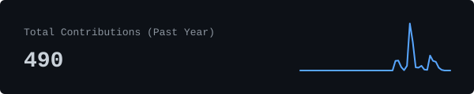
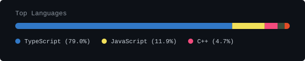
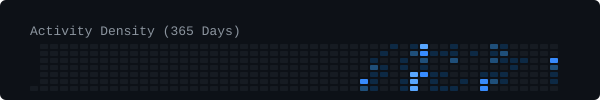

> "Founder of Self Graphic Lab | Co-Founder of ANTIINTERNS™ | AI Automation Builder | GTM Engineer | Creative Technologist | Computer Science Undergraduate"

  

### About Me

<samp>Asintha Dilhara · AI Automation Builder · GTM Engineer · Creative Technologist</samp>

I am a Computer Science undergraduate, AI Automation Builder, GTM Engineer, and Creative Technologist working at the intersection of artificial intelligence, software engineering, cloud computing, business growth, and digital creativity.

As the Founder of Self Graphic Lab and Co-Founder of ANTIINTERNS™, I build intelligent digital products, autonomous AI agents, RAG-powered applications, multi-agent architectures, business automation workflows, and scalable go-to-market systems.

My technical interests and experience span LLM integration, agentic workflows, MCP, API orchestration, lead generation, CRM automation, full-stack development, and cloud infrastructure using AWS and Microsoft Azure.

Alongside engineering, I work across branding, UI/UX design, multimedia production, and digital project management, combining technical problem-solving with creative execution to build practical, scalable digital solutions.

 

### Live Operational Metrics

  
  

  
  

 

### Core Stack & Expertise

- **Software Engineering**: Python, TypeScript, JavaScript, React, Node.js, Full-Stack Development, REST APIs.
- **AI & Agentic Engineering**: LLM Integration, RAG, AI Agents, Multi-Agent Systems, MCP, Prompt Engineering, Vector Databases.
- **GTM Engineering & Automation**: Lead Generation, CRM Automation, Sales Automation, Revenue Operations, Workflow Orchestration, Business Process Automation.
- **Cloud & Infrastructure**: AWS, Microsoft Azure, Cloudflare, Vercel, Docker, Cloud Deployment, CI/CD.
- **Developer & Automation Tools**: n8n, Git, GitHub Actions, Webhooks, API Integrations, Open-Source AI Tools.
- **Creative Technology & Design**: UI/UX Design, Branding, Graphic Design, 3D Modeling, Video Editing, Digital Project Management.

 

### Autonomous Architecture

The profile assets refresh daily at 05:17 UTC through GitHub Actions, with a manual trigger available. The portrait pipeline uses the repository's `assets/avatar.jpg`, a cached background-removal model, and contrast enhancement to regenerate the animated ASCII portrait (`portrait.svg`). Independently, the statistics pipeline queries GitHub's rate-limited GraphQL API for contributions and public, owned, non-fork repository languages, then generates `stats.svg`, `streak.svg`, `langs.svg`, and `year.svg`. Streaks and activity cover the past 365 days. Bounded network retries handle transient failures; failed generation preserves the last successful assets and reports a workflow failure. Successful assets are committed automatically, even if the other pipeline fails.

---

  <samp>© 2026 Asintha Dilhara · Built with Python, GitHub Actions, and SVG</samp>

